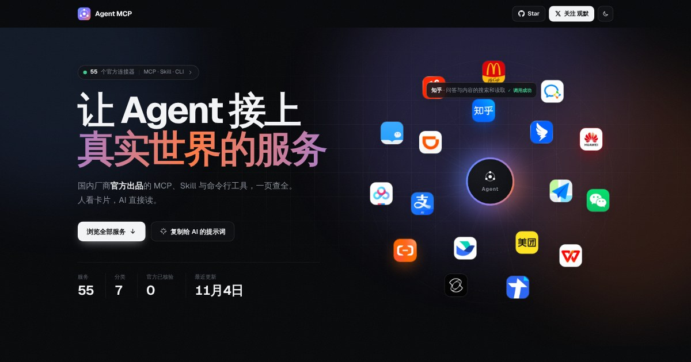

<!-- Generated by scripts/build.mjs from data/services.json. Edit the data and run npm run build; do not edit this file directly. -->

**English** · [简体中文](README.md)

<h1 align="center">Awesome Agent MCP</h1>

<p align="center"><b>Official MCP Servers · Agent Skills · CLIs from China</b><br>Connect your agent to AMap, Feishu, Meituan, Alipay, and more. Vendor-published integrations for people and AI agents.</p>

<p align="center">
  <a href="https://guanmo-ai.github.io/awesome-agent-mcp/"><b>Browse the website ↗</b></a> &nbsp;·&nbsp;
  <a href="#for-ai">For AI agents</a> &nbsp;·&nbsp;
  <a href="https://github.com/guanmo-ai/awesome-agent-mcp/issues/new?template=submit.yml">Submit a service</a> &nbsp;·&nbsp;
  <a href="https://x.com/guanmo_ai">Follow @guanmo_ai</a>
</p>

<p align="center"><sub>93 services · 7 categories · 91 verified · Updated 2026-11-04</sub></p>

## One Prompt for Your AI

Copy this prompt into an internet-enabled agent such as Claude Code, Codex, or Cursor:

```text
Read https://guanmo-ai.github.io/awesome-agent-mcp/llms.txt as an index of official MCP servers, skills, and CLIs from China. Find services for my needs, explain their requirements, and help configure them in my current agent. I will supply keys and authorize accounts myself.
```

<p align="center"><a href="https://guanmo-ai.github.io/awesome-agent-mcp/"></a></p>

> Only MCP servers, agent skills, and CLIs **published by the service vendor** are included. Community wrappers are excluded.

<a id="for-ai"></a>

## For AI Agents

**Already know the service you want?** Send this prompt, using Feishu as an example:

```text
Read https://guanmo-ai.github.io/awesome-agent-mcp/s/feishu/ and help connect Feishu to my current agent using its official documentation. I will supply keys and authorize accounts myself.
```

Let your agent read the index directly:

| Format | Address |
| :-- | :-- |
| llms.txt (readable index) | https://guanmo-ai.github.io/awesome-agent-mcp/llms.txt |
| JSON (structured data) | https://guanmo-ai.github.io/awesome-agent-mcp/services.json |
| GitHub raw file | https://raw.githubusercontent.com/guanmo-ai/awesome-agent-mcp/main/data/services.json |

You can also install the included skill [`agent-mcp-finder`](skills/agent-mcp-finder/SKILL.md). Then ask “Order me a Luckin coffee.” Your agent checks this index for official integrations, required keys, and configuration. For Claude Code:

```bash
mkdir -p ~/.claude/skills/agent-mcp-finder && curl -fsSL https://raw.githubusercontent.com/guanmo-ai/awesome-agent-mcp/main/skills/agent-mcp-finder/SKILL.md -o ~/.claude/skills/agent-mcp-finder/SKILL.md
```

**Ask your AI to install the finder skill:**

```text
Read https://raw.githubusercontent.com/guanmo-ai/awesome-agent-mcp/main/skills/agent-mcp-finder/SKILL.md and install agent-mcp-finder using my current agent's skill installation method. When I need to connect to a service from China, consult this official index first.
```

<a id="toc"></a>

## Contents

- [Travel & Life](#cat-life) (15)
- [Office](#cat-office) (15)
- [Notes & Storage](#cat-notes) (8)
- [Search & Data](#cat-search) (9)
- [Design & Creation](#cat-design) (8)
- [Payment & Finance](#cat-finance) (7)
- [Cloud & Dev](#cat-cloud) (31)

<a id="cat-life"></a>

## Travel & Life

| Service | Capabilities | Type | Permissions | Requirements | Status |
| :-- | :-- | :-- | :-- | :-- | :-- |
| [AMap](https://developer.amap.com/api/mcp-server/summary) · [Details](https://guanmo-ai.github.io/awesome-agent-mcp/s/amap/) | Look up places and weather, plan routes, generate maps, and build map applications. | MCP · Skill · CLI | 🟢 Read only | API key | ✅ Verified |
| [Baidu Maps](https://lbs.baidu.com/docs/ai?title=mcpserver/base) · [Details](https://guanmo-ai.github.io/awesome-agent-mcp/s/baidu-map/) | Search places, geocode addresses, and plan routes. | MCP | 🟢 Read only | API key | ✅ Verified |
| [Tencent Maps](https://lbs.qq.com/service/MCPServer/MCPServerGuide/overview) · [Details](https://guanmo-ai.github.io/awesome-agent-mcp/s/tencent-map/) | Search places, plan routes, and use location services. | MCP | 🟢 Read only | API key | ✅ Verified |
| [DiDi](https://mcp.didichuxing.com/) · [Details](https://guanmo-ai.github.io/awesome-agent-mcp/s/didi/) | Request rides, get fare estimates, and look up trips. | MCP · Skill | 🔴 Financial actions | Account authorization, API key | ✅ Verified |
| [Meituan](https://developer.meituan.com/ai-hub/mcp-list) · [Details](https://guanmo-ai.github.io/awesome-agent-mcp/s/meituan/) | Manage merchant orders, vouchers, products, and inventory, and query business data. | MCP · Skill · CLI | 🔴 Financial actions | Account authorization, Application required | ✅ Verified |
| [Taobao](https://tblifecdn.taobao.com/taobaopc/skills/taobao-native/SKILL.md) · [Details](https://guanmo-ai.github.io/awesome-agent-mcp/s/taobao/) | Search products and shop through the required desktop client. | MCP · Skill | 🔴 Financial actions | Desktop client, Account authorization | ✅ Verified |
| [McDonald's China](https://open.mcd.cn/mcp/doc) · [Details](https://guanmo-ai.github.io/awesome-agent-mcp/s/mcdonalds-cn/) | Order food and find restaurants and offers. | MCP | 🔴 Financial actions | Account authorization, API key | ✅ Verified |
| [Luckin Coffee](https://open.lkcoffee.com/docs) · [Details](https://guanmo-ai.github.io/awesome-agent-mcp/s/luckin/) | Order coffee and find stores. | MCP · Skill · CLI | 🔴 Financial actions | Account authorization, API key | ✅ Verified |
| [Fliggy](https://github.com/alibaba-flyai/flyai-skill) · [Details](https://guanmo-ai.github.io/awesome-agent-mcp/s/fliggy/) | Search flights, hotels, and attractions, with prices and booking links. | Skill · CLI | 🟢 Read only | Free | ✅ Verified |
| [Tongcheng Shanglv](https://tmc.ly.com/zh/resources/updates/open-mcp-skills-cli) · [Details](https://guanmo-ai.github.io/awesome-agent-mcp/s/ly-tmc/) | Find business travel options, check travel policies, and recommend itineraries. | MCP · Skill · CLI | 🟢 Read only | Account authorization, Application required | ✅ Verified |
| [Caiyun (ColorfulClouds) Weather](https://github.com/caiyunapp/mcp-caiyun-weather) · [Details](https://guanmo-ai.github.io/awesome-agent-mcp/s/caiyun-weather/) | Query current weather, hourly forecasts, air quality, and weather alerts. | MCP | 🟢 Read only | API key | ✅ Verified |
| [VariFlight](https://ai.variflight.com/zh/docs/aviation) · [Details](https://guanmo-ai.github.io/awesome-agent-mcp/s/variflight/) | Query flight status, connections, fares, airport weather, and aircraft positions. | MCP | 🟢 Read only | API key, Account authorization, Membership or payment | ✅ Verified |
| [Tuniu](https://open.tuniu.com/mcp/docs/guide/mcp-auth.html) · [Details](https://guanmo-ai.github.io/awesome-agent-mcp/s/tuniu/) | Search and book hotels, flights, trains, tickets, cruises, and vacation packages. | MCP · Skill · CLI | 🔴 Financial actions | Account authorization, API key | ✅ Verified |
| [Kuaidi100](https://api.kuaidi100.com/document/how-to-use-mcp-service) · [Details](https://guanmo-ai.github.io/awesome-agent-mcp/s/kuaidi100/) | Track shipments, estimate shipping costs and delivery times, and place authorized pickup orders. | MCP · Skill | 🔴 Financial actions | API key, Account authorization, Application required | ✅ Verified |
| [Trip.Biz](https://openapi.ctripbiz.com/#/advertise/mcp) · [Details](https://guanmo-ai.github.io/awesome-agent-mcp/s/ctrip-business/) | Query travel policies, flights, hotels, and itineraries, and retrieve travel and compliance data. | MCP | 🟢 Read only | Account authorization, Application required | ✅ Verified |

<sub>[↑ Back to contents](#toc)</sub>

<a id="cat-office"></a>

## Office

| Service | Capabilities | Type | Permissions | Requirements | Status |
| :-- | :-- | :-- | :-- | :-- | :-- |
| [Feishu](https://github.com/larksuite/cli) · [Details](https://guanmo-ai.github.io/awesome-agent-mcp/s/feishu/) | Work with messages, documents, calendars, and multidimensional tables. | MCP · Skill · CLI | 🟡 Write access | Account authorization | ✅ Verified |
| [DingTalk](https://open.dingtalk.com/document/ai-dev/dingtalk-server-api-mcp-overview) · [Details](https://guanmo-ai.github.io/awesome-agent-mcp/s/dingtalk/) | Query and manage messages, documents, spreadsheets, work logs, calendars, and tasks. | MCP | 🟡 Write access | Account authorization | ✅ Verified |
| [WeCom](https://work.weixin.qq.com/nl/index/aicli) · [Details](https://guanmo-ai.github.io/awesome-agent-mcp/s/wecom/) | Use enterprise messaging, contacts, and workplace applications. | MCP · Skill · CLI | 🟡 Write access | Account authorization, API key | ✅ Verified |
| [Tencent Docs](https://docs.qq.com/open/document/mcp/) · [Details](https://guanmo-ai.github.io/awesome-agent-mcp/s/tencent-docs/) | Read and edit online documents and spreadsheets. | MCP · Skill | 🟡 Write access | Account authorization, Free | ✅ Verified |
| [Tencent Meeting](https://cloud.tencent.com/document/product/1095/133826) · [Details](https://guanmo-ai.github.io/awesome-agent-mcp/s/tencent-meeting/) | Schedule and manage meetings, and retrieve attendance, recordings, transcripts, and minutes. | MCP · Skill · CLI | 🟡 Write access | Account authorization | ✅ Verified |
| [WPS](https://open.wps.cn/documents/app-integration-dev/mcp-server/introduction) · [Details](https://guanmo-ai.github.io/awesome-agent-mcp/s/wps/) | Query and manage enterprise documents and collaboration data through WPS 365 APIs. | MCP | 🟡 Write access | Account authorization, Application required | ✅ Verified |
| [KDocs](https://github.com/kdocs-app/kdocs-skill) · [Details](https://guanmo-ai.github.io/awesome-agent-mcp/s/kdocs/) | Read and collaborate on online documents. | Skill · CLI | 🟡 Write access | Account authorization | ⏳ Unverified |
| [Yuque](https://github.com/yuque/yuque-mcp-server) · [Details](https://guanmo-ai.github.io/awesome-agent-mcp/s/yuque/) | Read and write knowledge bases and documents. | MCP | 🟡 Write access | Account authorization, API key | ✅ Verified |
| [Agently Mail (QQ Mail Team)](https://github.com/Tencent/AgentlyMail) · [Details](https://guanmo-ai.github.io/awesome-agent-mcp/s/qq-mail/) | Use an agent mailbox to send, receive, search, and organize email and manage attachments. | Skill · CLI | 🟡 Write access | Account authorization | ✅ Verified |
| [Tencent Lexiang](https://github.com/tencent-lexiang/lexiang-mcp-skill) · [Details](https://guanmo-ai.github.io/awesome-agent-mcp/s/lexiang/) | Search and edit knowledge documents and smart tables, manage files, and import meeting materials. | MCP · Skill | 🟡 Write access | Account authorization, API key | ✅ Verified |
| [TextIn](https://www.textin.com/news/20250707161156842) · [Details](https://guanmo-ai.github.io/awesome-agent-mcp/s/textin/) | Recognize text in images and documents, extract fields and tables, and convert documents to Markdown. | MCP | 🟢 Read only | API key | ✅ Verified |
| [MinerU](https://github.com/opendatalab/MinerU-Ecosystem) · [Details](https://guanmo-ai.github.io/awesome-agent-mcp/s/mineru/) | Parse PDFs, Office files, images, and web pages into Markdown and structured data. | MCP · Skill · CLI | 🟡 Write access | Free, API key | ✅ Verified |
| [Dida365](https://help.dida365.com/articles/7438132116019216384) · [Details](https://guanmo-ai.github.io/awesome-agent-mcp/s/dida/) | Query and manage tasks, lists, habits, focus records, and anniversaries. | MCP · CLI | 🟡 Write access | Account authorization | ✅ Verified |
| [Feishu Project](https://project.feishu.cn/b/helpcenter/1ykiuvvj/wzb3ycsc) · [Details](https://guanmo-ai.github.io/awesome-agent-mcp/s/feishu-project/) | Query and update projects, work items, and related data within account permissions. | MCP | 🟡 Write access | Account authorization | ✅ Verified |
| [Tencent TAPD](https://cloud.tencent.com/developer/mcp/server/11474) · [Details](https://guanmo-ai.github.io/awesome-agent-mcp/s/tapd/) | Query and manage requirements, tasks, bugs, iterations, and comments. | MCP | 🟡 Write access | Account authorization, API key | ✅ Verified |

<sub>[↑ Back to contents](#toc)</sub>

<a id="cat-notes"></a>

## Notes & Storage

| Service | Capabilities | Type | Permissions | Requirements | Status |
| :-- | :-- | :-- | :-- | :-- | :-- |
| [WeRead](https://weread.qq.com/r/weread-skills) · [Details](https://guanmo-ai.github.io/awesome-agent-mcp/s/weread/) | Access bookshelves, notes, and highlights. | Skill | 🟢 Read only | Account authorization, API key | ✅ Verified |
| [Tencent ima](https://ima.qq.com/agent-interface) · [Details](https://guanmo-ai.github.io/awesome-agent-mcp/s/ima/) | Search, read, and update personal knowledge bases. | Skill | 🟡 Write access | Account authorization, API key | ✅ Verified |
| [flomo](https://help.flomoapp.com/advance/mcp/) · [Details](https://guanmo-ai.github.io/awesome-agent-mcp/s/flomo/) | Capture and retrieve short notes. | MCP | 🟡 Write access | Account authorization, Membership or payment | ✅ Verified |
| [Yinxiang Biji](https://guide.yinxiang.com/docs/yxai/skill.html) · [Details](https://guanmo-ai.github.io/awesome-agent-mcp/s/yinxiang/) | Create, search, and organize notes. | Skill | 🟡 Write access | Account authorization, Membership or payment | ✅ Verified |
| [Youdao Note](https://note.youdao.com/help-center/skill-guide.html) · [Details](https://guanmo-ai.github.io/awesome-agent-mcp/s/youdao-note/) | Read, write, and search notes, manage tasks, and clip web pages. | Skill · CLI | 🟡 Write access | Account authorization, API key | ✅ Verified |
| [Quark Drive](https://www.quark.cn/documents/help/quark-drive-skill) · [Details](https://guanmo-ai.github.io/awesome-agent-mcp/s/quark-drive/) | Search and manage cloud drive files. | Skill | 🟡 Write access | Account authorization | ✅ Verified |
| [Tencent Weiyun](https://www.weiyun.com/act/openclaw) · [Details](https://guanmo-ai.github.io/awesome-agent-mcp/s/weiyun/) | Search and manage cloud drive files. | Skill | 🟡 Write access | Account authorization, API key | ✅ Verified |
| [Baidu Netdisk](https://pan.baidu.com/union/doc/mcp-server/使用概述/) · [Details](https://guanmo-ai.github.io/awesome-agent-mcp/s/baidu-netdisk/) | Search, upload, and manage cloud drive files. | MCP | 🟡 Write access | Account authorization | ✅ Verified |

<sub>[↑ Back to contents](#toc)</sub>

<a id="cat-search"></a>

## Search & Data

| Service | Capabilities | Type | Permissions | Requirements | Status |
| :-- | :-- | :-- | :-- | :-- | :-- |
| [Zhihu](https://developer.zhihu.com/docs?key=zhihu_cli) · [Details](https://guanmo-ai.github.io/awesome-agent-mcp/s/zhihu/) | Search Zhihu and the web, read trends and personal content, and retrieve or upload knowledge base files. | MCP · Skill · CLI | 🟡 Write access | Account authorization, API key | ✅ Verified |
| [Qichacha](https://agent.qcc.com/guide) · [Details](https://guanmo-ai.github.io/awesome-agent-mcp/s/qcc/) | Look up company registration and risk information. | MCP · CLI | 🟢 Read only | Account authorization, API key | ✅ Verified |
| [Tianyancha](https://github.com/tyc-tech/tyc-cli) · [Details](https://guanmo-ai.github.io/awesome-agent-mcp/s/tianyancha/) | Look up company registration and corporate relationships. | MCP · Skill · CLI | 🟢 Read only | Account authorization | ✅ Verified |
| [Douyin Open Platform](https://developer.open-douyin.com/docs/resource/zh-CN/dop/ability/mcp-service/mcp-service-desc) · [Details](https://guanmo-ai.github.io/awesome-agent-mcp/s/douyin-open/) | Use official video and image-text search, deep links, and business tasks. | MCP | 🟡 Write access | Account authorization, Application required | ✅ Verified |
| [Ocean Engine](https://open.oceanengine.com/mcp?app_id=1841425772187712) · [Details](https://guanmo-ai.github.io/awesome-agent-mcp/s/oceanengine/) | Query authorized advertising accounts, campaign metrics, and reports. | MCP | 🟢 Read only | Account authorization, API key | ✅ Verified |
| [Huayu Yuandian](https://open.chineselaw.com/mcp-config/) · [Details](https://guanmo-ai.github.io/awesome-agent-mcp/s/yuandian/) | Search laws, cases, corporate and securities compliance materials, and check legal hallucinations. | MCP · Skill | 🟢 Read only | API key | ✅ Verified |
| [Tencent Yuanbao Search](https://cloud.tencent.com/developer/mcp/server/11764) · [Details](https://guanmo-ai.github.io/awesome-agent-mcp/s/yuanbao-search/) | Search current web and vertical sources, with site, freshness, and result-count filters. | MCP | 🟢 Read only | Account authorization, API key | ✅ Verified |
| [Baidu AI Search](https://cloud.baidu.com/doc/BAIDU_AI_SEARCH/index.html) · [Details](https://guanmo-ai.github.io/awesome-agent-mcp/s/baidu-search/) | Search current web pages, images, and videos, with site and result-type filters. | MCP | 🟢 Read only | — | ✅ Verified |
| [Baidu Baike](https://cloud.baidu.com/doc/qianfan/s/tmh4stryt) · [Details](https://guanmo-ai.github.io/awesome-agent-mcp/s/baidu-baike/) | Query encyclopedia senses, entry details, and short explainer videos. | MCP | 🟢 Read only | — | ✅ Verified |

<sub>[↑ Back to contents](#toc)</sub>

<a id="cat-design"></a>

## Design & Creation

| Service | Capabilities | Type | Permissions | Requirements | Status |
| :-- | :-- | :-- | :-- | :-- | :-- |
| [Modao](https://modao.cc/feature/ai-mcp.html) · [Details](https://guanmo-ai.github.io/awesome-agent-mcp/s/modao/) | Generate and edit prototypes, PRDs, apps, and images, and read or export existing prototypes. | MCP | 🟡 Write access | Account authorization, API key | ✅ Verified |
| [Kling AI](https://github.com/klingai-tech/skills) · [Details](https://guanmo-ai.github.io/awesome-agent-mcp/s/kling/) | Generate videos and images with AI. | Skill · CLI | 🟡 Write access | — | ⏳ Unverified |
| [MiniMax](https://github.com/MiniMax-AI/MiniMax-MCP) · [Details](https://guanmo-ai.github.io/awesome-agent-mcp/s/minimax/) | Synthesize and clone voices, generate images and videos, and use text and search via CLI. | MCP · Skill · CLI | 🟡 Write access | Account authorization, API key, Membership or payment | ✅ Verified |
| [NetEase Cloud Music](https://music.163.com/st/ncmcli) · [Details](https://guanmo-ai.github.io/awesome-agent-mcp/s/netease-music/) | Search and play music, manage playlists, upload cloud files, and publish image-text posts. | Skill · CLI | 🟡 Write access | Account authorization, API key | ✅ Verified |
| [AntV](https://github.com/antvis/mcp-server-chart) · [Details](https://guanmo-ai.github.io/awesome-agent-mcp/s/antv/) | Turn structured data into charts and choose visualizations for analytical tasks. | MCP · Skill | 🟡 Write access | Free | ✅ Verified |
| [MeituHub](https://www.meituhub.com/zh-cn/docs?id=150) · [Details](https://guanmo-ai.github.io/awesome-agent-mcp/s/meituhub/) | Use a CLI for image, video, and audio creation, including local batch processing. | CLI | 🟡 Write access | API key, Membership or payment | ✅ Verified |
| [Tencent Hunyuan Image](https://cloud.tencent.com/developer/mcp/server/11765) · [Details](https://guanmo-ai.github.io/awesome-agent-mcp/s/hunyuan-image/) | Generate and edit images, expand images, and enhance clarity. | MCP | 🟡 Write access | Account authorization, API key | ✅ Verified |
| [Volcengine veImageX](https://github.com/volcengine/mcp-server/tree/main/server/mcp_server_veimagex) · [Details](https://guanmo-ai.github.io/awesome-agent-mcp/s/volc-veimagex/) | Query and upload image assets, generate images, enhance quality, expand images, and recognize text. | MCP | 🟡 Write access | Account authorization, API key | ✅ Verified |

<sub>[↑ Back to contents](#toc)</sub>

<a id="cat-finance"></a>

## Payment & Finance

| Service | Capabilities | Type | Permissions | Requirements | Status |
| :-- | :-- | :-- | :-- | :-- | :-- |
| [Alipay](https://aipay.alipay.com/merchant-guide) · [Details](https://guanmo-ai.github.io/awesome-agent-mcp/s/alipay/) | Authorize payments, process transactions, check payment status, and integrate payment collection. | Skill · CLI | 🔴 Financial actions | Account authorization | ✅ Verified |
| [Weixin Pay](https://pay.weixin.qq.com/doc/v3/merchant/4019638116) · [Details](https://guanmo-ai.github.io/awesome-agent-mcp/s/wechat-pay/) | Get payment integration guidance and examples, assess integrations, and query payments and refunds. | Skill · CLI | 🟢 Read only | Account authorization | ✅ Verified |
| [UnionPay](https://open.unionpay.com/tjweb/solution/detail?solId=613) · [Details](https://guanmo-ai.github.io/awesome-agent-mcp/s/unionpay/) | Connect agents to UnionPay payment services through MCP. | MCP | 🔴 Financial actions | — | ✅ Verified |
| [Tonghuashun iFinD](https://mcp.51ifind.com/) · [Details](https://guanmo-ai.github.io/awesome-agent-mcp/s/ifind/) | Query market prices, financial statements, announcements, macroeconomic indicators, and other financial data. | MCP · Skill | 🟢 Read only | Account authorization, API key, Membership or payment | ✅ Verified |
| [Tonghuashun iWencai](https://search.10jqka.com.cn/skillhub) · [Details](https://guanmo-ai.github.io/awesome-agent-mcp/s/iwencai/) | Use official skills to query prices, announcements, research, and macro data, and screen by conditions. | Skill · CLI | 🟢 Read only | Account authorization, API key | ✅ Verified |
| [East Money Miaoxiang](https://ai.eastmoney.com/skills) · [Details](https://guanmo-ai.github.io/awesome-agent-mcp/s/eastmoney-miaoxiang/) | Analyze financial news and data, screen stocks, and manage watchlists and simulated portfolios. | Skill | 🟡 Write access | Account authorization, API key | ✅ Verified |
| [Guosen Securities Xiaoxin](https://www.guosen.com.cn/gs/xxskills/index.html) · [Details](https://guanmo-ai.github.io/awesome-agent-mcp/s/guosen/) | Query macroeconomic, market, and financial data, compare funds, and screen stocks and ETFs. | Skill | 🟢 Read only | Account authorization, API key | ✅ Verified |

<sub>[↑ Back to contents](#toc)</sub>

<a id="cat-cloud"></a>

## Cloud & Dev

| Service | Capabilities | Type | Permissions | Requirements | Status |
| :-- | :-- | :-- | :-- | :-- | :-- |
| [Alibaba Cloud](https://help.aliyun.com/zh/openapi/user-guide/openapi-mcp-server-guide) · [Details](https://guanmo-ai.github.io/awesome-agent-mcp/s/aliyun/) | Query and manage cloud resources. | MCP | 🟡 Write access | Account authorization | ✅ Verified |
| [Tencent Cloud](https://cloud.tencent.com/document/product/1278/131433) · [Details](https://guanmo-ai.github.io/awesome-agent-mcp/s/tencent-cloud/) | Query and manage cloud resources. | Skill · CLI | 🟡 Write access | Account authorization | ✅ Verified |
| [Huawei Cloud](https://github.com/huaweicloud/huaweicloud-mcp) · [Details](https://guanmo-ai.github.io/awesome-agent-mcp/s/huawei-cloud/) | Query and manage cloud resources. | MCP · Skill | 🟡 Write access | Account authorization, API key | ✅ Verified |
| [Volcengine](https://github.com/volcengine/mcp-server) · [Details](https://guanmo-ai.github.io/awesome-agent-mcp/s/volcengine/) | Access cloud resources and AI capabilities. | MCP | 🟡 Write access | Account authorization, API key | ✅ Verified |
| [Baidu AI Cloud](https://ai.baidu.com/ai-doc/REFERENCE/mm9tjwod0) · [Details](https://guanmo-ai.github.io/awesome-agent-mcp/s/baidu-cloud/) | Use OCR, document parsing, image processing, face recognition, and speech capabilities. | MCP | 🟡 Write access | Account authorization, API key | ✅ Verified |
| [Qiniu Cloud](https://github.com/qiniu/qiniu-mcp-server) · [Details](https://guanmo-ai.github.io/awesome-agent-mcp/s/qiniu/) | Read and write object storage, process images, refresh or prefetch CDN content, and manage live streams. | MCP | 🟡 Write access | Account authorization, API key | ✅ Verified |
| [Zhipu](https://docs.bigmodel.cn/cn/coding-plan/mcp/search-mcp-server) · [Details](https://guanmo-ai.github.io/awesome-agent-mcp/s/zhipu/) | Search the web and retrieve current information for GLM Coding Plan users. | MCP | 🟢 Read only | Account authorization, Membership or payment, API key | ✅ Verified |
| [Gitee](https://gitee.com/oschina/mcp-gitee) · [Details](https://guanmo-ai.github.io/awesome-agent-mcp/s/gitee/) | Manage code repositories, issues, and pull requests. | MCP | 🟡 Write access | Account authorization, API key | ✅ Verified |
| [JiHu GitLab](https://docs.gitlab.cn/docs/jh/user/model_context_protocol/mcp_server/) · [Details](https://guanmo-ai.github.io/awesome-agent-mcp/s/jihulab/) | Manage code repositories and DevOps workflows. | MCP | 🟡 Write access | Account authorization | ✅ Verified |
| [Tencent EdgeOne Makers](https://edgeone.cloud.tencent.com/pages/document/173172415568367616) · [Details](https://guanmo-ai.github.io/awesome-agent-mcp/s/edgeone-makers/) | Deploy static sites, full-stack apps, and agent projects, and generate public access links. | MCP · Skill · CLI | 🟡 Write access | Account authorization | ✅ Verified |
| [Apifox](https://docs.apifox.com/apifox-mcp-server) · [Details](https://guanmo-ai.github.io/awesome-agent-mcp/s/apifox/) | Read API documentation and run API tests from the command line. | MCP · CLI | 🟡 Write access | API key | ✅ Verified |
| [Sealos](https://sealos.io/docs/AI/mcp/) · [Details](https://guanmo-ai.github.io/awesome-agent-mcp/s/sealos/) | Create development environments, manage databases, and query bills, monitoring data, and logs. | MCP | 🟡 Write access | Account authorization | ✅ Verified |
| [Tencent CloudBase](https://docs.cloudbase.net/ai/cloudbase-ai-toolkit/) · [Details](https://guanmo-ai.github.io/awesome-agent-mcp/s/cloudbase/) | Manage cloud databases, functions, storage, and app deployments, with development workflows. | MCP · Skill · CLI | 🟡 Write access | Account authorization | ✅ Verified |
| [Milvus / Zilliz](https://milvus.io/docs/milvus_and_mcp.md) · [Details](https://guanmo-ai.github.io/awesome-agent-mcp/s/milvus/) | Search vector data, inspect database schemas, and manage collections and records. | MCP | 🟡 Write access | — | ✅ Verified |
| [API7 APISIX](https://docs.api7.ai/apisix/reference/apisix-mcp) · [Details](https://guanmo-ai.github.io/awesome-agent-mcp/s/apisix/) | Query and manage API gateway routes, upstreams, plugins, consumers, and certificate settings. | MCP | 🟡 Write access | API key | ✅ Verified |
| [Higress](https://github.com/higress-group/higress-ops-mcp-server) · [Details](https://guanmo-ai.github.io/awesome-agent-mcp/s/higress/) | Query and manage gateway routes, services, and configuration through MCP. | MCP | 🟡 Write access | — | ✅ Verified |
| [Espressif ESP RainMaker](https://mcp.espressif.com/) · [Details](https://guanmo-ai.github.io/awesome-agent-mcp/s/esp-rainmaker/) | Query and control IoT devices, set device parameters, and manage automation schedules. | MCP | 🟡 Write access | Account authorization | ✅ Verified |
| [TiDB](https://docs.pingcap.com/zh/ai/tidb-mcp-claude-desktop/) · [Details](https://guanmo-ai.github.io/awesome-agent-mcp/s/tidb/) | Query and modify databases in natural language, and manage table schemas and database users. | MCP | 🟡 Write access | — | ✅ Verified |
| [Tencent Cloud Code Analysis (TCA)](https://cloud.tencent.com/developer/mcp/server/11709) · [Details](https://guanmo-ai.github.io/awesome-agent-mcp/s/tencent-tca/) | Run code analysis and query code quality, security defects, and analysis reports. | MCP | 🟡 Write access | Account authorization, API key, Application required | ✅ Verified |
| [Tencent TDesign](https://cloud.tencent.com/developer/mcp/server/11721) · [Details](https://guanmo-ai.github.io/awesome-agent-mcp/s/tdesign/) | Retrieve component lists, documentation, DOM structures, and release changes for UI development. | MCP | 🟢 Read only | Free | ✅ Verified |
| [Tencent CODING DevOps](https://cloud.tencent.com/developer/mcp/server/11722) · [Details](https://guanmo-ai.github.io/awesome-agent-mcp/s/coding/) | Manage development projects, work items, repositories, and merge requests. | MCP | 🟡 Write access | Account authorization, API key | ✅ Verified |
| [Tencent DNSPod](https://cloud.tencent.com/developer/mcp/server/11743) · [Details](https://guanmo-ai.github.io/awesome-agent-mcp/s/dnspod/) | Query and manage DNS domains, and retrieve DNS records and usage. | MCP | 🟡 Write access | — | ✅ Verified |
| [Tencent WeData Semantic Layer](https://cloud.tencent.com/developer/mcp/server/11763) · [Details](https://guanmo-ai.github.io/awesome-agent-mcp/s/tencent-wedata/) | Discover data assets and query business data through enterprise metadata and semantic models. | MCP | 🟢 Read only | — | ✅ Verified |
| [Tencent Cloud Object Storage (COS)](https://github.com/Tencent/cos-mcp) · [Details](https://guanmo-ai.github.io/awesome-agent-mcp/s/tencent-cos/) | Upload, download, and search cloud files, and process images, videos, and documents. | MCP | 🟡 Write access | Account authorization, API key | ✅ Verified |
| [Tencent Cloud Log Service (CLS)](https://cloud.tencent.com/document/product/614/118699) · [Details](https://guanmo-ai.github.io/awesome-agent-mcp/s/tencent-cls/) | Search and analyze logs, and query monitoring metrics and alert records. | MCP | 🟢 Read only | Account authorization, API key | ✅ Verified |
| [Volcengine ByteHouse](https://github.com/volcengine/mcp-server/tree/main/server/mcp_server_bytehouse) · [Details](https://guanmo-ai.github.io/awesome-agent-mcp/s/volc-bytehouse/) | Inspect databases and tables, query data, and execute DML and DDL statements. | MCP | 🟡 Write access | Account authorization, API key | ✅ Verified |
| [Volcengine veFaaS Browser-Use](https://github.com/volcengine/mcp-server/tree/main/server/mcp_server_vefaas_browser_use) · [Details](https://guanmo-ai.github.io/awesome-agent-mcp/s/volc-browser-use/) | Start cloud browser tasks and query their status and results. | MCP | 🟡 Write access | Account authorization | ✅ Verified |
| [iFLYTEK Cloud](https://www.xfyun.cn/xfyun-cli/doc) · [Details](https://guanmo-ai.github.io/awesome-agent-mcp/s/xfyun/) | Manage applications and usage, and use speech, OCR, translation, image, and digital human capabilities. | Skill · CLI | 🟡 Write access | Account authorization | ✅ Verified |
| [Alibaba Cloud Model Studio](https://docs.agent.bailian.aliyun.com/en/bailian-cli/getting-started/installation) · [Details](https://guanmo-ai.github.io/awesome-agent-mcp/s/aliyun-bailian/) | Use image and video models, and manage applications, tasks, and platform resources. | Skill · CLI | 🟡 Write access | Account authorization | ✅ Verified |
| [Alibaba Cloud Simple Log Service (SLS)](https://help.aliyun.com/en/sls/sls-mcp-server) · [Details](https://guanmo-ai.github.io/awesome-agent-mcp/s/aliyun-sls/) | Find projects and LogStores, query and analyze logs, and diagnose alerts. | MCP | 🟢 Read only | Account authorization | ✅ Verified |
| [Alibaba Cloud DMS Agent Data Gateway](https://help.aliyun.com/zh/dms/use-cases/migrate-from-dms-mcp-to-agent-data-gateway-mcp) · [Details](https://guanmo-ai.github.io/awesome-agent-mcp/s/aliyun-dms/) | Discover database assets, query permissions and knowledge, and execute authorized SQL. | MCP | 🟡 Write access | Account authorization | ✅ Verified |

<sub>[↑ Back to contents](#toc)</sub>

## Legend

- **Type**: `MCP` is a standard interface for agents to call external services; a `Skill` teaches an agent how to use a service; a `CLI` is a command-line tool an agent can invoke.
- **Permissions**: 🟢 Read only, without modifying data; 🟡 Write access, which can create or modify data; 🔴 Financial actions, which may place orders or make payments and require final human confirmation.
- **Status**: ✅ Verified means vendor ownership has been confirmed with evidence; ⏳ Unverified means the entry was collected from public sources and has not yet been individually verified.

## Inclusion Criteria

1. Published by the service vendor, on its own domain or under its official GitHub organization.
2. Serves users in China and can be used by agents through MCP, a skill, or a CLI.
3. Third-party reposts, community wrappers, and reverse-engineered interfaces are excluded.
4. In addition to vendor ownership, meets at least one criterion: a listed company or its controlled subsidiary; an official China App Store app with ≥ 10,000 ratings; an official main open-source repository with ≥ 10,000 stars; or explicit maintainer inclusion (Gitee, JiHu GitLab, Apifox).

See [docs/VERIFYING.md](docs/VERIFYING.md). Found an omission or error? [Submit a service](https://github.com/guanmo-ai/awesome-agent-mcp/issues/new?template=submit.yml) or [report a problem](https://github.com/guanmo-ai/awesome-agent-mcp/issues/new?template=correction.yml).

## License

Code is licensed under [MIT](LICENSE). Service names and trademarks belong to their respective vendors. Created and maintained by [Guanmo @guanmo_ai](https://x.com/guanmo_ai).
